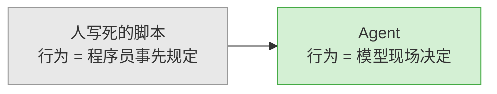
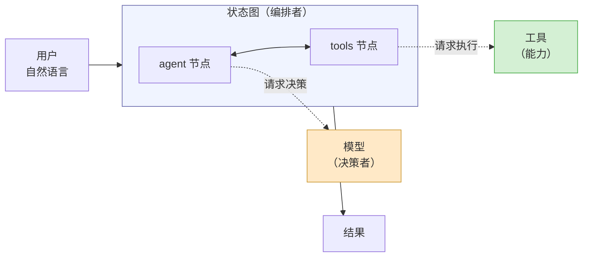
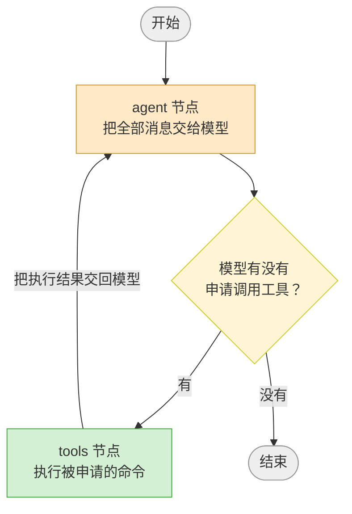
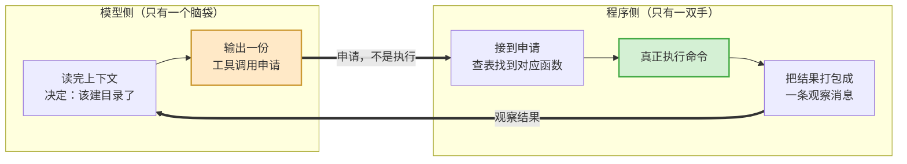
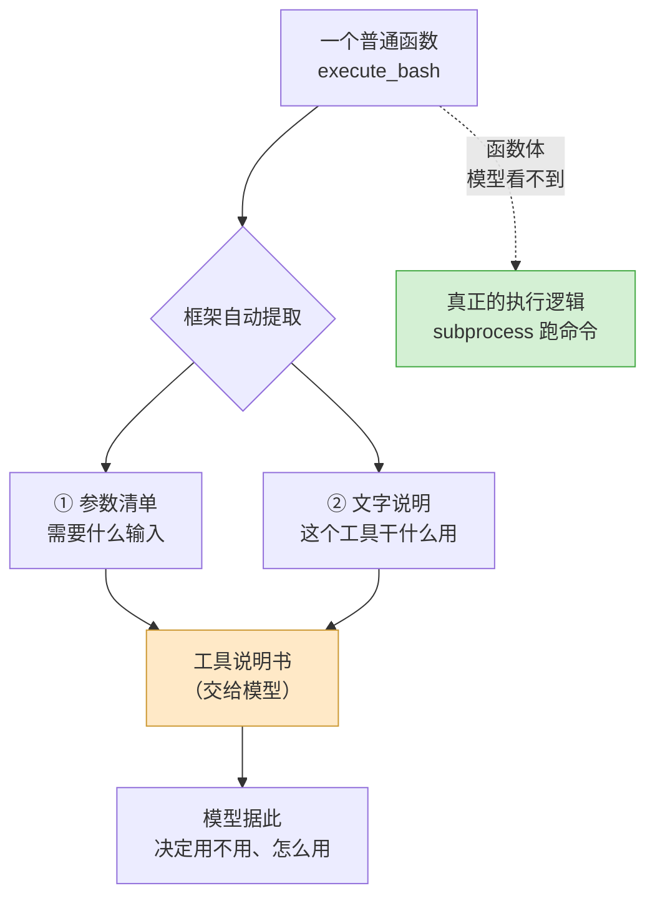
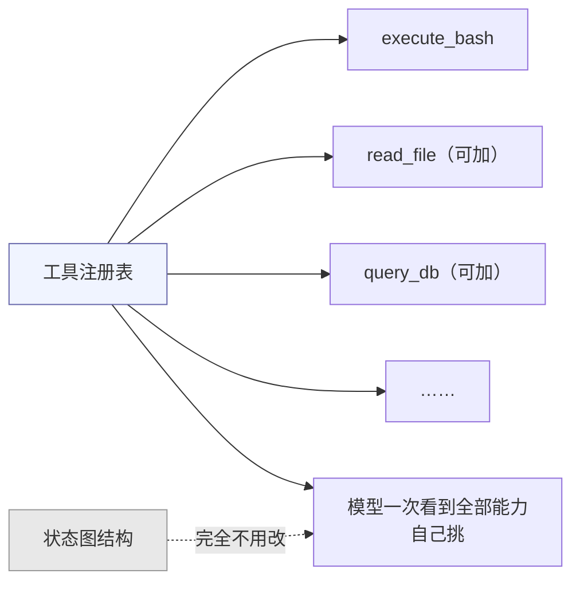
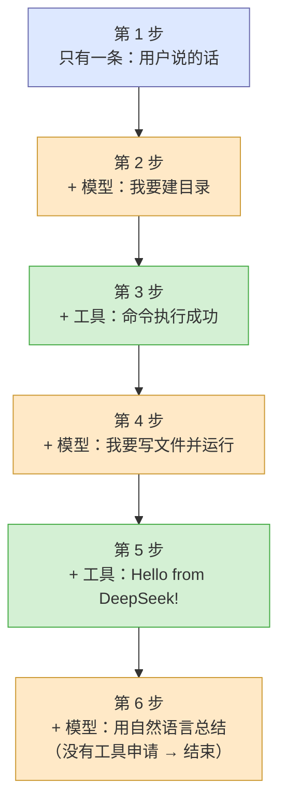
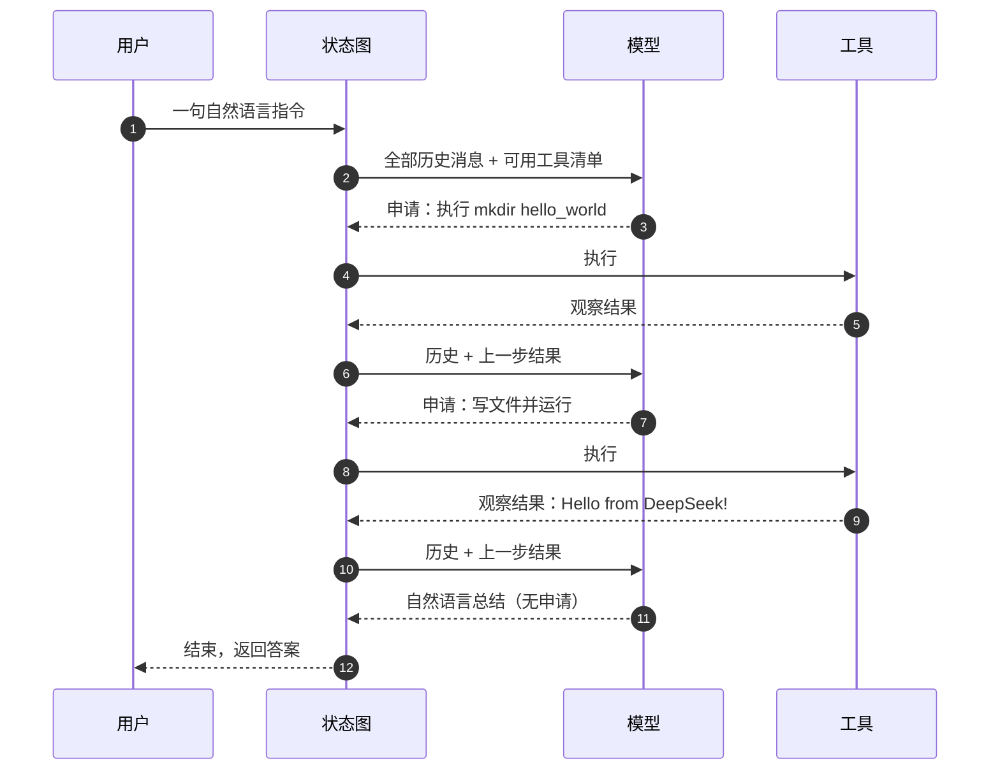
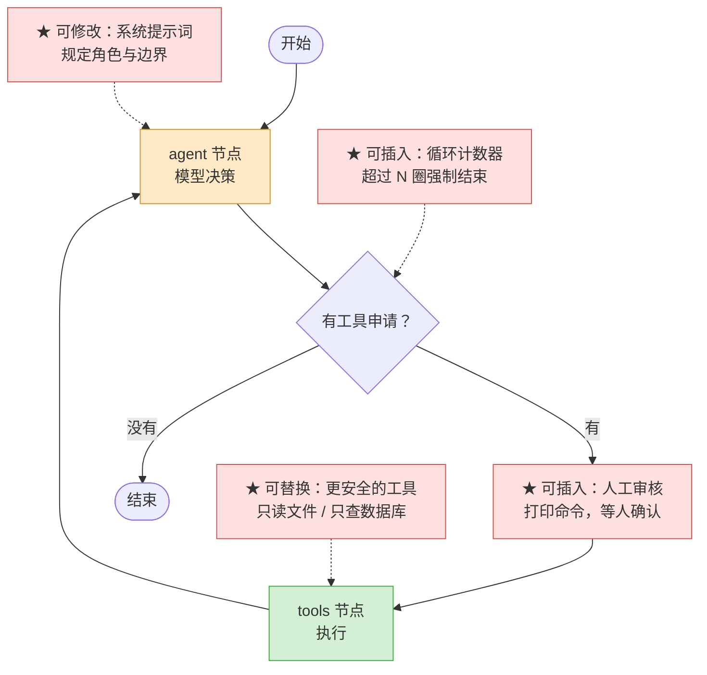
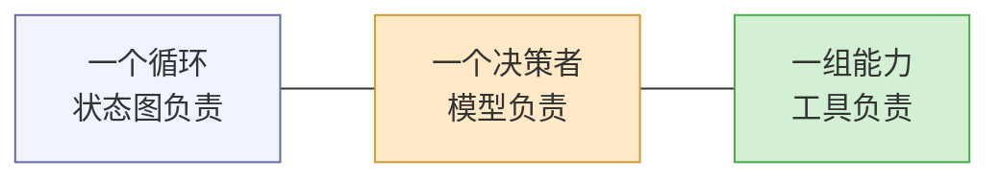

# jca-simple —— 最小可运行的 ReAct Agent

一个用 **LangGraph + LangChain + DeepSeek** 搭建的最小 Agent 示例，全部逻辑不到 70 行，跑通「模型思考 → 调用工具 → 观察结果 → 再思考」的完整闭环。

---

## 一、先看它做了什么

给程序一句自然语言：

> 新建一个 hello_world 目录，在里面创建一个 app.py 文件，写入 print('Hello from DeepSeek!') 并运行它。

然后什么都不用管，它自己完成：建目录 → 写文件 → 运行 → 汇报结果。

运行结束后，项目里多出一个 `hello_world/app.py`。

**这是整门课的分水岭**：`app.py` 不是提前写好的，是模型自己动手创建的。理解了这个区别，才理解为什么需要下面这套架构。

---

## 二、全貌：一个循环，三个角色

整个项目可以压缩成一张图：

三个角色，职责严格分离：

| 角色 | 对应概念 | 一句话职责 | 代码位置 |
| --- | --- | --- | --- |
| **编排者** | LangGraph 状态图 | 决定「下一步谁上场」 | `main.py:47-60` |
| **决策者** | LLM（DeepSeek） | 决定「现在该做什么」 | `main.py:29-38` |
| **能力** | Tool（工具函数） | 决定「能做到什么」 | `main.py:13-26` |

> **后面所有内容，都是在这张图上做展开。**

---

## 三、核心循环：ReAct 是怎么转起来的

**① 循环靠一段「回到模型」的边闭合。** 工具执行完必须把结果送回模型眼前，模型才能基于观察结果决定下一步。少了这条回边，Agent 就退化成「一问一答」，只能调一次工具。

**② 停止条件不是额外写的判断，而是模型的自然行为。** 判断框里问的只有一件事：模型这次的输出里有没有「工具调用申请」。
- 有 → 继续循环
- 没有 → 说明模型认为可以直接用自然语言回答了 → 结束

**这就是 ReAct 范式的精髓**：不需要写「任务完成了吗」这种逻辑，模型不再申请工具，循环就停了。

**③ 两个节点各自不知道全局。** agent 节点不知道有没有工具可调、也不知道下步去哪；tools 节点不知道任务目标是什么、也不关心还要不要继续。所有「谁接谁」的关系都被提到图上，用连线和判断框表达。

---

## 四、最关键的一句话：决策与执行是分离的

这是初学者最容易混淆的地方，也是本课重点。

**模型从头到尾没有执行过任何一条命令。** 它只是输出了一段结构化的「申请」——大意是「我想调用 `execute_bash`，参数是 `mkdir hello_world`」。真正 `mkdir` 的是我们自己的 Python 进程。

这个分离带来两个直接好处，可以当作课堂讨论题：

1. **可拦截**：申请和执行之间是代码，我们可以在这里加审核、加白名单、加限流。
2. **可替换**：换工具、换模型，另一边几乎不用动。

---

## 五、工具：Agent 的能力边界

工具是「模型能做的事」的清单。用装饰器把普通函数注册成工具时，框架会自动从函数里抽出两样东西给模型看：

两个必须讲清楚的设计点：

**① 文字说明是写给模型看的产品说明书，不是给同事看的注释。** 写得不清楚，模型就会选错工具或传错参数。本项目用中文描述，既贴合模型的理解习惯，也避开了提示词里的特殊字符问题。

**② 函数体模型是看不到的，它只知道「有这个能力、需要什么参数」。** 这就是封装——模型面向接口，不面向实现。

**③ 工具应当永远返回文字，出错时返回错误说明，而不是抛异常。** 因为返回值会被塞回对话里当作「观察结果」给模型看。**报错信息本身也是一种有效的观察结果**，模型会据此换一条路走——这是 Agent 能自我纠错的原因。

### 能力是可扩展的

加一个新工具，只需要把它放进注册表，**图的结构一行都不用改**。这是把「能力」和「流程」分开设计的好处：流程是稳定的骨架，能力是随时可插拔的模块。

---

## 六、状态：图中流动的到底是什么

节点之间传递的东西，是一条**不断增长的消息列表**。每个节点接收整个状态，返回「要追加进去的新消息」。

**每转一圈，列表就长两条**：模型的一次申请、工具的一次结果。所以「循环转了几圈」在调试时是可以直接数出来的——**看消息列表的长度就知道。**

这也解释了为什么节点函数写得那么短：它不需要关心历史消息是怎么攒起来的，只管读全量、追加新的一条。累加的工作由框架的「消息归并」规则统一处理。

> 课堂演示建议：终端里逐步打印这条列表，让学生亲眼看到它一格格长出来。**调试 Agent 时，看消息轨迹比看日志有效得多。**

---

## 七、一次完整任务的时序

把前面几张图合起来，就是一次真实运行的全过程：

注意看这张图里的两个规律：

- **模型每次都看到全部历史**，包括之前每一次申请和执行结果。它没有「记忆」，所谓记忆就是每次都把完整列表重新发一遍。
- **最后一步一定是模型发出的自然语言**，不是工具。工具永远是配角，收尾的永远是模型。

---

## 八、常见疑问

**Q：报错说找不到 API key？**
检查环境变量文件是否在项目根目录、变量名是否拼写正确，以及它是否在模型初始化之前被加载（`main.py:10`）。

**Q：为什么关掉程序就没有记忆了？**
状态只存在内存里，程序一停就丢了。要做多轮对话，需要给会话一个编号，并配一个存盘机制（如 `MemorySaver`）把状态持久化。

**Q：模型会不会乱敲命令？**
会，而且这是**本示例故意留下的教学缺口**。工具里执行的是任意 shell 命令，请只在教学机器上运行。怎么补救见下一节。

**Q：想加第二个工具怎么办？**
放进注册表即可，图不用改。这也是一道很好的课后练习——**让学生自己体会「加能力」和「改流程」的成本差异。**

---

## 九、这套骨架的扩展点

下面可以做什么练习

四个红色星号就是四个练习方向，由易到难：

1. **改提示词**：让 Agent 换个任务，比如「统计当前目录有多少个 Python 文件」。
2. **加工具**：加一个读文件的工具，看模型会不会在两种能力之间选对。
3. **加日志**：每转一圈打印消息列表长度，观察它转了几圈、第几圈停。
4. **加人工审核**：在决策和执行之间插一个确认环节，拒绝时把「用户拒绝执行」作为观察结果回给模型——**这正是「决策与执行分离」的价值兑现点**。
5. **限流保护**：加计数器，超过 N 圈强制结束，防止模型陷入死循环狂刷 API。
6. **换模型**：换成其他 OpenAI 兼容服务，只改模型名和地址，体会这套抽象的通用性。

---

## 十、一句话总结

> Agent = **一个循环** + **一个决策者** + **一组能力**。

把这三者的边界划清楚，剩下的都是工程细节。
