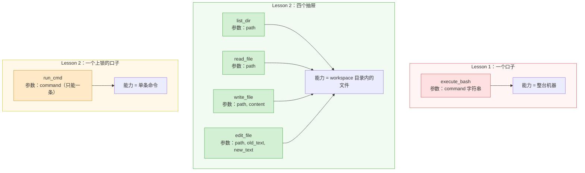
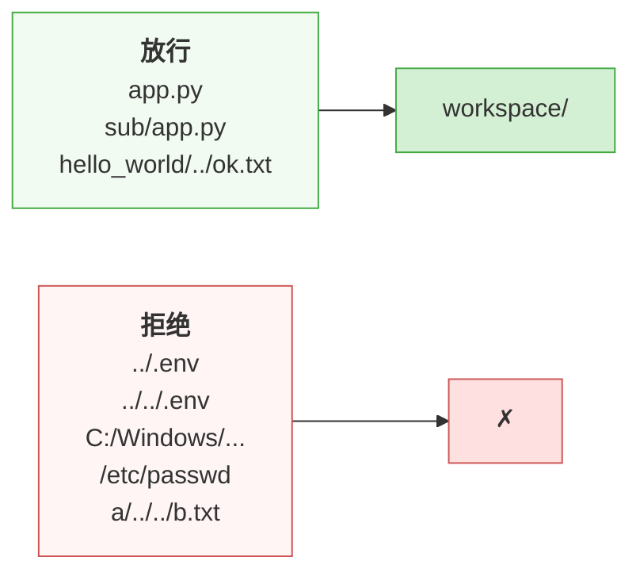
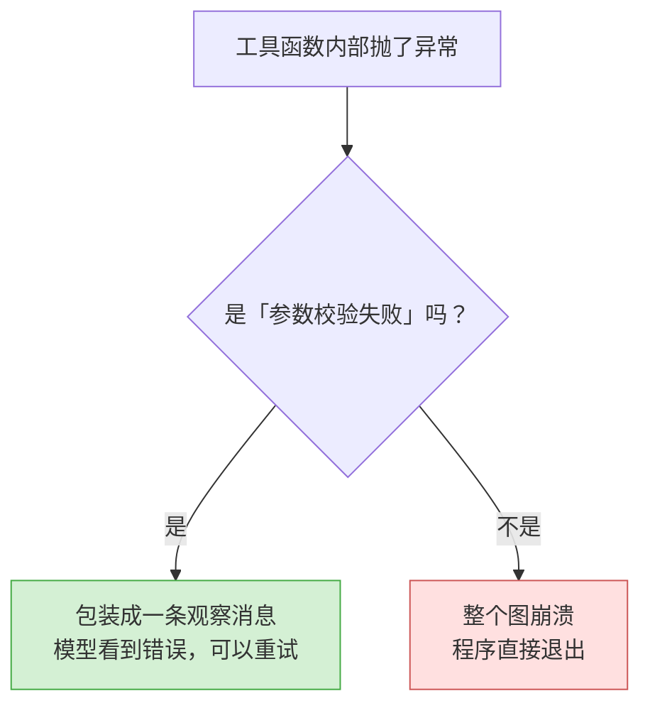
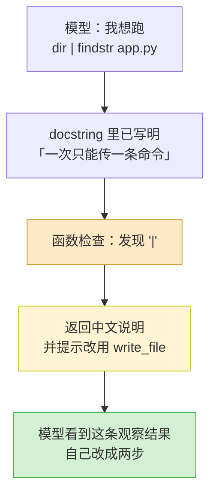

# jca-simple Lesson 2 —— 给 Agent 的能力装上边界

Lesson 1 用一个 `execute_bash` 把 Agent 跑通了。它也能干活，但它的能力边界是**整台机器**。

这一节把那个口子收起来：把「一个万能工具」换成「一组各有形状的工具」，并给它们加上路径沙箱。

---

## 一、先承认 Lesson 1 留了什么

Lesson 1 第八章自问自答了一题：

> **Q：模型会不会乱敲命令？**
> 会，而且这是**本示例故意留下的教学缺口**。工具里执行的是任意 shell 命令，请只在教学机器上运行。


「乱敲命令」其实是两件不同的事：一件会**改坏东西**（问题 1），一件会让**请求根本发不出去**（问题 4）。中间还夹着两件容易被忽略的：模型不知道该用哪套语法（问题 2），以及一条真实的 bug（问题 3）。

四个问题都能指着代码说清楚。

### 问题 1：能力的形状是「无限」

```python
# Lesson 1 的 main.py:18-20
subprocess.run(
    command, shell=True, capture_output=True, text=True, timeout=60
)
```

`command` 是一个**字符串**，交给系统解释器去解释。这意味着模型能做的事没有形状：

| 模型可以 | 因为 |
| --- | --- |
| 删掉整个目录 | `rd /s /q something` |
| 读到 API key | `type ..\.env` |
| 改掉你自己的代码 | `copy x.py main.py` |
| 下载并运行外部程序 | `curl ... && ./x` |

Lesson 1 第五章讲过：**工具就是 Agent 的能力边界**。那么一个接受任意字符串的工具，等于没有边界。

### 问题 2：模型得靠猜才知道自己在哪台机器上

`shell=True` 在 Windows 上走 `cmd.exe`，在 Linux 上走 `/bin/sh`。这两套语法不一样。而模型看到的工具说明里，对自己脚下是什么系统**一无所知**。

于是它只能按训练数据里最常见的那套（类 Unix）来写命令。本机实测（把 PATH 收窄成只有 Windows 自带工具）：

| 模型可能写的 | 在 `cmd.exe` 上 |
| --- | --- |
| `mkdir hello_world` | ✅ 能用 |
| `mkdir -p a/b` | ❌ 语法不正确（`cmd.exe` 的 `mkdir` 不认 `-p`） |
| `ls -la` | ❌ 找不到 `ls` |
| `cat README.md` | ❌ 找不到 `cat` |
| `rm -rf x` | ❌ 找不到 `rm` |

**真正麻烦的不是「全错」，而是「时对时错」。** 这台机器上装了 Git Bash，PATH 里就有 `ls`/`cat`/`rm`，那几条又会「碰巧能用」——换个没装的机器就全挂。**模型看不见 PATH，它在赌。**

这不是模型笨，是**你没告诉它**。

### 问题 3：一个真实的 bug，不只是「不够安全」

```python
# Lesson 1 的 main.py:24
return output.strip() if output.strip() else "命令执行成功（无输出）。"
```

`result.returncode` 被完全忽略了。后果：

- `rd /s /q 重要目录` 没有输出 → 回报「命令执行成功」；
- 一条静默失败的命令（stderr 也没写东西）→ 同样回报「命令执行成功」。

**模型拿不到「成功 / 失败」这个信号，它就失去了自我纠错的前提。**

### 问题 4：命令一多，请求直接被风控拦下

这条不是「能力太大」，而是「**东西根本发不出去**」。`document/issues.md` 里记着现场：

```
Error code: 400 - ... code: 'sensitive_words_detected'
(...(4) cybersecurity or technical integrity violations.)
```

原因是llm生成的命令里面有修改文件等bash 命令，导致llm风控。

把工具 docstring 里的技术词换成中文——但那只治了**描述**，没治**行为**。

所以这一节的工具设计顺着同一个思路往下做了两件事：

| 红线 | 做法 |
| --- | --- |
| 少用英文技术词 | docstring、返回值、错误文案全用中文：「错误输出」而不是 `stderr`，「退出码」而不是 `returncode` |
| 别让模型输出多条命令 | `run_cmd` 一次只收一条（见第五章），把「多条」从行为上消掉——而不只是换个说法 |

> 顺带一个更彻底的解法：工具名本身也会进请求体。`execute_bash` 这个名字里带着 `bash`，而实际上它在 Windows 上跑的是 `cmd.exe`——**名字既不安全也不准确**，所以改名 `run_cmd`。

> 这四个问题是 Lesson 2 的全部动机。改造的目标不是「让代码更漂亮」，而是**让模型的每一句话都能被验证、被发出去**。

---

## 二、从「一个万能工具」到「一组有形状的工具」

Lesson 1 第五章那张图说得很清楚：框架从函数里抽出**参数清单**和**文字说明**交给模型。这两样东西加起来，就是模型眼里的「我能做什么」。

既然工具说明是模型看到的全世界，那么**缩小工具 = 缩小模型的行动空间**。



对应到文件：

```
tools/
  sandbox.py    # 路径闸门：四个文件工具共用
  files.py      # list_dir / read_file / write_file / edit_file
  shell.py      # run_cmd（高危，单独放）
tools/__init__.py   # 注册表 build_tools()
prompts/system.py   # 系统提示词
```

**为什么按危险程度拆文件**：`files.py` 里的能力都被沙箱约束着，`shell.py` 里的没有。放在一起，读代码的人分不清哪段是需要警惕的。分开之后，「哪些能力是有边界的」一眼可见。

---

## 三、沙箱：把一个目录变成 Agent 的全世界

四个文件工具的入口都先过这一道闸门（`tools/sandbox.py`）：

```python
# tools/sandbox.py:7
WORKSPACE = (Path.cwd() / "workspace").resolve()


# tools/sandbox.py:10-15
def safe_path(raw: str) -> Path:
    """把模型给的相对路径解析成工作目录下的真实路径；越界就报错。"""
    target = (WORKSPACE / raw).resolve()
    if not target.is_relative_to(WORKSPACE):
        raise ValueError(f"路径超出工作目录范围，只允许操作 {WORKSPACE} 内的文件。")
    return target
```

短短几行，但每一行都有理由：

| 写法 | 为什么必须这样 |
| --- | --- |
| `Path.cwd()` 而不是 `Path(__file__).parent` | 项目要打包成 exe（`jca.spec`）。打包后 `__file__` 指向解包用的临时目录，没有意义；`cwd()` 是「你在哪儿运行它」，符合「在这儿跑，文件就落在这儿」的直觉 |
| `.resolve()` | 它会**展开符号链接**、把 `..` 和 `.` 算干净。不 resolve 的话 `hello_world/../../.env` 这种字符串骗得过 `is_relative_to` |
| `is_relative_to()` 而不是 `startswith()` | 后者有经典漏洞：`/work/workspace-evil` 以 `/work/workspace` 开头，但它是另一个目录 |

### 实测：哪些路径进得来



注意 `hello_world/../ok.txt` 是**放行**的——它 normalize 之后确实落在工作区里。沙箱拦的是「越界」，不是「长得可疑」。

### 为什么是 `raise` 而不是 `return 错误字符串`

`safe_path` 抛异常，四个工具各自在 `try/except` 里接住，转成给模型看的中文。这样**校验逻辑写一遍，文案生成各管各的**——`read_file` 说「读取失败」，`write_file` 说「写入失败」，共用同一个闸门。

---

## 四、为什么工具绝不能把异常抛出去

Lesson 1 第 159 行写过一条原则：

> **工具应当永远返回文字，出错时返回错误说明，而不是抛异常。**

当时它读起来像「编码风格建议」。这一节把它的**硬性理由**补上——实测 `langgraph` 的 `ToolNode`：

```python
# .venv/Lib/site-packages/langgraph/prebuilt/tool_node.py:383-391
def _default_handle_tool_errors(e: Exception) -> str:
    if isinstance(e, ToolInvocationError):
        return e.message
    raise e            # ← 不是参数校验错，就原样抛出去
```

`ToolNode` 构造时的默认参数就是它（`tool_node.py:753`）。所以：



**结论**：只要工具里可能因为业务原因失败（路径越界、文件不存在、编码不对），就必须自己接住。

所以 `tools/files.py` 里每个工具都是这个形状：

```python
# tools/files.py:54-76（节选）
@tool
def read_file(path: str, max_chars: int = MAX_READ_CHARS) -> str:
    """读取工作目录下某个文本文件的内容。"""
    try:
        target = safe_path(path)          # ← 这里可能抛「路径超出范围」
        if not target.exists():
            return f"文件不存在：{path}"
        ...
    except Exception as e:
        return f"读取失败：{e}"            # ← 一律变成文字
```

这条约束还有一个更积极的意义：**错误信息是模型自我纠错的燃料**。返回「文件不存在」，模型就会换个路径或先去建文件；直接崩掉，它什么也学不到。

---

## 五、`run_cmd`：保留能力，但把它锁上

完全删掉执行命令的能力，会让 Lesson 2 的演示少一半——「写个脚本并运行它」是 Agent 最直观的价值。所以保留，但加两道锁。

### 锁 1：只允许一条命令

```python
# tools/shell.py:10
BLOCKED_CHARS = "&|;<>`$\n\r"
```

这些字符的共同点是：**它们让「一条命令」变成「多条」或者「接管输入输出」**。

| 字符 | 在 Windows 上会干什么 |
| --- | --- |
| `&` `&&` | 依次执行多条命令 |
| `|` | 把前一条的输出喂给后一条 |
| `;` | （类 Unix）依次执行 |
| `>` `<` | 重定向，直接读写文件——绕过文件工具 |
| `` ` `` `$` | 命令替换，把一条命令的结果拼进另一条 |
| 换行 | 就是多条命令 |

检查函数把结果分成两类（`tools/shell.py:13-26`）：合格返回 `None`，不合格返回**一段给模型看的中文说明**：

```python
# tools/shell.py:17-23
hit = next((c for c in command if c in BLOCKED_CHARS), None)
if hit:
    return (
        f"命令里出现了 {hit!r}，它会把多条命令连在一起或者接管输入输出。"
        "本工具一次只能执行一条命令：请拆开逐条调用。"
        "如果需要把文字写进文件，请改用 write_file 工具。"
    )
```

注意最后一句：**不只是拒绝，还给出了替代方案**。

这就是「双管齐下」——文档里说明 + 函数里检查：



**模型违规不是失败，是一次教学机会。** 它拿到的不是「程序崩了」，而是一句话教它怎么做对——这正是 Lesson 1 说的「决策与执行分离」的价值兑现点。

### 锁 2：顺手修掉那个 bug

```python
# tools/shell.py:52-57
output = (result.stdout or "").strip()
if result.stderr:
    output += f"\n[错误输出]\n{result.stderr.strip()}"
if result.returncode != 0:
    output += f"\n（命令退出码：{result.returncode}，说明它没有正常结束。）"
```

现在「成功」和「失败」是两种不同的观察结果，模型能分辨了。

另外两处细节：

- `cwd=WORKSPACE` —— 命令的工作目录也落在工作区里，不是项目根目录；
- `errors="replace"` —— 中文 Windows 上命令输出常是 GBK 编码，不加这个，遇到非 GBK 字节会抛 `UnicodeDecodeError`，而根据上一节的结论，这个异常会**把整个图搞崩**。

> 这个设计有个保守的取舍：**引号里的 `&` 也会被拒**（比如 `echo "a & b"`）。这是故意的——宁可误拒，也不要放过一条绕过沙箱的路径。模型完全可以改用 `write_file`。

---

## 六、让模型不必猜操作系统

Lesson 1 的问题 2 的解法很简单：**把它脚下的事实告诉它**。

```python
# prompts/system.py:8-17
def build_system_prompt() -> str:
    """把本机的操作系统和工作目录告诉模型，省得它去猜。"""
    return (
        "你是一个严格的编程agent。\n"
        f"当前运行环境：{platform.system()} {platform.release()}"
        f"（版本 {platform.version()}，{platform.machine()} 架构）。\n"
        f"工作目录：{WORKSPACE}，所有文件操作都限制在这个目录内。\n"
        "请只使用已经提供的工具，不要凭猜测假设本机的系统或路径。"
    )
```

本机实测输出：

```
你是一个严格的编程agent。
当前运行环境：Windows 11（版本 10.0.26200，AMD64 架构）。
工作目录：D:\work\src\jca-simple\workspace，所有文件操作都限制在这个目录内。
请只使用已经提供的工具，不要凭猜测假设本机的系统或路径。
```

它作为第一条 `SystemMessage` 进对话（`main.py:63`）：

```python
inputs = {
    "messages": [
        SystemMessage(content=build_system_prompt()),
        ("user", prompt),
    ]
}
```

**为什么放在 `inputs` 里而不是每轮追加**：状态里的消息列表是「一次次追加」的（Lesson 1 第六章）。放进去一次就固定在那里，不会每转一圈重复一遍、把上下文越撑越长。

**为什么单独拆成 `prompts/` 包而不是写死在 `main.py`**：提示词是最需要反复试的东西。做成包之后，加「角色设定」「few-shot 示例」「按任务切换模板」都是**新增文件**，`main.py` 一行都不用动——和工具注册表是同一个思路。

---

## 七、一次真实的运行轨迹

跑 `uv run main.py`，指令是：

> 在 hello_world 目录下创建 app.py，内容是 print('Hello from DeepSeek!')，并且运行确保结果正确

消息列表长这样（`tools` 是五个工具都注册的状态）：

| 圈 | 谁 | 动作 | 观察结果 |
| --- | --- | --- | --- |
| 1 | 模型 | `list_dir(".")` | **目录不存在：.** |
| 2 | 模型 | `list_dir(绝对路径)` + `list_dir("hello_world")` | 都是「目录不存在」（这一圈发了两个申请） |
| 3 | 模型 | `write_file("hello_world/app.py", ...)` | 已新建，共写入 30 个字符 |
| 4 | 模型 | `read_file(...)` + `run_cmd("python hello_world/app.py")` | 文件内容正确 / `Hello from DeepSeek!` |
| 5 | 模型 | 用自然语言总结（无工具申请） | 结束 |

（终端只打印每一圈的最后一条消息，所以第 2、4 圈里两个并行申请的结果只显示了后一个。）

对照 Lesson 1 第六章那张表：**每转一圈，列表长两条**。这次转了 4 圈 + 1 次收尾，比 Lesson 1 的单圈丰富得多——因为任务是「写 + 验证 + 运行」三段，模型必须看到前一步的结果才能决定下一步。

两个值得课堂上停下来看的细节：

**① 第 2 圈模型同时发了两个工具申请。** ReAct 循环不要求「一次只申请一个」。模型可以并行地试探两条路，两个结果都会回到它的眼前。

**② 第 4 圈把 `read_file` 和 `run_cmd` 一起发了。** 模型自己决定「读文件校验内容」和「运行验证行为」是两件独立的事。这个判断**不是你写死的**——你只是给了它两个工具。

最后模型自己给出了一句总结，还主动指出了一个问题（见下节）。

---

## 八、这次改动暴露的问题（诚实清单）

教学材料最忌讳「演示成功了所以设计是对的」。这次跑下来有几个真实的问题：

### 问题 A：`list_dir` 的报错没给出出路

第 1 圈模型写 `list_dir(".")`，拿到的是：

```
目录不存在：.
```

于是它第 2 圈去猜路径了——试了绝对路径、试了 `hello_world`，两次都失败，**白白烧了两圈 API**，最后才发现 `write_file` 会自动建父目录。

问题不在模型，在**错误信息的质量**。它说了「不存在」，但没说「你可以用 write_file 直接创建」。更好的写法应该是：

```
目录不存在：. （你可以直接用 write_file 新建文件，父目录会自动创建。）
```

这印证了 Lesson 1 的第 ③ 条原则——**报错信息是写给模型的产品说明书**，不是写给同事的调试日志。同一个原则，Lesson 1 讲的是「要返回错误而不是抛异常」，Lesson 2 补上了下半句：**返回什么措辞，直接决定模型下一圈走哪条路。**

### 问题 B：换行和编码会被悄悄改掉

`Path.write_text()` 在 Windows 上默认会把内容里的 `\n` 翻译成 `\r\n`，而且默认按 UTF-8 写。后果：

- 编辑一个 LF 行尾的文件 → 整个文件变成 CRLF；
- 编辑一个 GBK 编码的文件 → 整个文件变成 UTF-8。

对一个「只改一个字」的操作来说，这是不可接受的副作用。修法是显式指定、并且**记住原编码**：

```python
# tools/files.py:17-28：解码时把用到的编码一起带出来
def _decode(raw: bytes) -> tuple[str, str] | None:
    for encoding in ("utf-8", "gbk"):
        try:
            return raw.decode(encoding), encoding
        except UnicodeDecodeError:
            continue
    return None

# tools/files.py:120-123：按原编码写回，且不做换行翻译
updated = text.replace(old_text, new_text, 1)
target.write_text(updated, encoding=encoding, newline="")
```

`newline=""` 的意思是「不做换行翻译」——写进去什么就是什么。实测：LF 文件编辑后仍是 LF，CRLF 文件编辑后仍是 CRLF，GBK 文件编辑后仍是 GBK。

> **这是一条通用教训**：工具的「副作用范围」应该和它的意图一样窄。`edit_file` 的意图是「改一处文字」，它就不该顺手改掉整个文件的编码和行尾。

### 问题 C：四处文字还在说「默认关闭」，但代码已经默认打开了

这一节演示用的是「五个工具全部注册」的状态：`build_tools()` 里直接 `tools.append(run_cmd)`，没有环境变量开关。但**四处文字还停留在旧设计**：

| 位置 | 还写着 |
| --- | --- |
| `README.md:109-110` | "It is off unless you set `JCA_ALLOW_SHELL=1`" |
| `tools/__init__.py:14` | 「执行命令的能力属于高危能力，需要用环境变量显式打开」 |
| `tools/shell.py:1` | 「默认关闭的高危能力」 |
| `main.py:17` | 「执行命令的能力需要显式打开」 |

**代码和文档不一致了。** 两条路选一条：

1. 恢复开关（`if os.getenv("JCA_ALLOW_SHELL") == "1": tools.append(run_cmd)`），四处文字都不用改；
2. 确认「默认开放」是有意的，那就**把四处文字一起改掉**，别再声称它是 opt-in。

> 这是本课最值得复盘的一处：**改行为容易，改描述行为的文字容易忘。** 而且这个项目的特殊之处在于——文档里的措辞会被写进 system prompt，而工具 docstring 是**每次请求都发给模型**的。`tools/shell.py:1` 那句「默认关闭」不只误导读者，它还会让模型以为自己手上的 `run_cmd` 是个受限能力。

顺带两个小尾巴：`tools/__init__.py:3` 的 `import os` 现在没用了；`__all__` 从三项缩成了 `["build_tools"]`，`FILE_TOOLS` 和 `run_cmd` 仍可直接 import，但不在 `__all__` 里了。

> **课堂讨论题**：为什么「代码改了、文档没改」是比「代码有 bug」更常见的事故？一个提示词项目里，README 里那句 `JCA_ALLOW_SHELL=1` 会不会被模型读到？

---

## 九、扩展练习

比 Lesson 1 的练习更进一步——这次的目标是**让边界更精确**，而不是更多：

1. **修好问题 A 的措辞**：把各工具的错误信息改成「说明 + 出路」。跑几次看模型是不是少转几圈。
2. **给 `list_dir` 加递归选项**：加一个 `recursive: bool = False` 参数，注意深度上限和条目上限——否则一个 `node_modules` 就能撑爆上下文。
3. **给 `read_file` 加行号**：让模型能说「第 12 行有问题」，为下一步的 `edit_file` 定位做准备。
4. **做一次「工具太多」的实验**：把 `edit_file` 去掉再跑同一个任务，看模型是不是只能用 `write_file` 整文件重写。体会**能力粒度**对模型行为的影响。
5. **给文件工具加人工审核**：在 `ToolNode` 外面包一层（`wrap_tool_call`），写文件之前先打印路径 + 内容前 100 字，等回车确认。这是 Lesson 1 练习 4 的正式版。
6. **让 `run_cmd` 的拒绝变成可配置**：现在引号里的 `&` 也会被拒。试试写一个更精确的解析（或者直接承认做不到，保持保守）——**体会「安全」和「可用」的取舍没有免费午餐**。

---

## 十、一句话总结

> Lesson 1：Agent = 一个循环 + 一个决策者 + 一组能力。
> **Lesson 2：给那组能力划出边界，并在模型越界时好好告诉它为什么。**


三者缺一不可：**没有能力，Agent 什么也做不了；没有边界，它能做的太多了；没有反馈，它撞到边界时只会一直撞。**

Lesson 1 讲的是「决策与执行分离」，Lesson 2 讲的是**分离出来的那个执行者，手里到底该有什么**。
