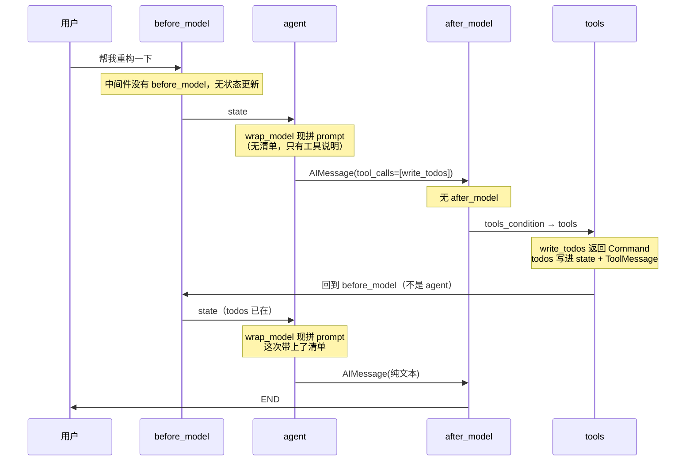
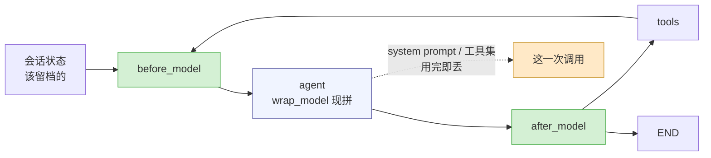

# jca-simple Lesson 3 —— 在模型之前，留一道可插拔的口子

Lesson 2 把 Agent 的**能力**收进了一个目录：一组有形状的工具 + 一道路径沙箱。

这一节换一个方向，动的是另一头：**每次把请求发给模型之前，我们还能做什么？**

---

## 一、先承认前两课留了什么

前两课都没碰过 `engine/agent.py` 里那个 `_agent_node`。它一直是这样的（本课之前的版本）：

```python
# engine/agent.py（本课之前）
llm = ChatOpenAI(...)                      # 构造时
self._llm = llm.bind_tools(tool_list)      # 构造时绑死工具

async def stream_turn(self, prompt):
    inputs = {"messages": [SystemMessage(content=..., id="sys"), ("user", prompt)]}
    ...

def _agent_node(self, state):
    return {"messages": [self._llm.invoke(state["messages"])]}
```

**三件事被写死在这里**：

| 写死的东西 | 位置 | 代价 |
| --- | --- | --- |
| 系统提示词是构造时定死的一段字符串 | `prompts/system.py:8` 拼一次，`__init__` 收下 | 想按当前状态改一个字，只能重建整个 engine |
| 系统提示词每一轮都塞进 state 历史 | `stream_turn` 里的 `SystemMessage(..., id="sys")` | 靠固定 id 反复替换才不至于攒下三份；「只对这一次成立」的内容被永久留在对话里 |
| 工具在构造时 `bind_tools` 绑死 | `JCAEngine.__init__` | 中途想加一个工具、减一个工具，做不到 |

单看每一条都不算 bug，凑在一起就变成一个结构问题：**想在这个节点里多做一件事，就得改这个节点本身。** 而「在这个节点里多做一件事」恰恰是 Agent 项目里发生得最频繁的改动——

- 任务复杂时，给模型一份当前计划（本课要做的）；
- 历史太长时，压缩掉中间那段；
- 手上有一堆 skill / MCP，但一次只想挂相关的几个；
- 命中某个状态时，临时加一段「注意，你正在生产环境」。

每一条都去 `_agent_node` 里加一个 `if`，几轮下来就没有人能读懂它了。

---

## 二、把「一次模型调用」变成一个可以被插手的东西

先问一个更小的问题：这些改动的**作用范围**一样吗？

不一样，而且是两种截然不同的东西：

| | 例子 | 该不该留档 |
| --- | --- | --- |
| 改的是**会话状态** | 「用户已经确认过了」、待办清单本身 | 该，下一轮还要用 |
| 改的是**这一次请求** | 临时加的一段提示词、这次挂哪几个工具 | 不该，用完即丢 |

这个区分就是整个设计的支点。**系统提示词属于第二类** —— 它是「这次怎么问」，不是「会话是什么」。把它存进 state 会带来两个后果：一份已经过期的上下文被永远带在对话里，每一轮都重新发给模型（白烧 token）；以及「谁在什么时候改过它」变得不可知。

于是把「一次调用」抽成一个对象：

```python
# engine/middleware/base.py:60
@dataclass
class ModelRequest:
    state: Any                 # 整份会话状态（中间件按需读）
    messages: list[AnyMessage] # 这次要发的对话消息，**不含** system prompt
    system_prompt: str         # 基础提示词 + 各中间件追加的
    tools: list[BaseTool]      # 这次要绑的工具
```

`ModelRequest` **每次调用新建一份，用完即丢**，不进 state、不进 checkpointer。中间件通过 `wrap_model` 插手它：

```python
def wrap_model(self, request, handler):
    request = replace(request, system_prompt=request.system_prompt + "\n" + 我的段落)
    return handler(request)
```

`handler` 是「剩下的中间件 + 真正的那次调用」。调 `handler(request)` 就是交棒给下一层；不调、直接返回一个 `AIMessage` 也合法（那是「这一层替模型做了决定」），本项目的中间件都只往 request 上加东西。

**这就是洋葱模型**：多个中间件按声明顺序由外到内嵌套，A 声明在 B 前面，A 先跑，A 拿到的 handler 里包着 B。

```mermaid
flowchart LR
    R1["ModelRequest<br/>基础 prompt"] --> A["中间件 A<br/>append A"]
    A --> B["中间件 B<br/>append B"]
    B --> I["_invoke<br/>真调用"]

    R2["最终发出的 prompt"] -.="基础提示<br/><br/>A 的段落<br/><br/>B 的段落"<br/>.- I

    style A fill:#d4f0d4,stroke:#4a4
    style B fill:#f0f4ff,stroke:#66a
```

一件容易忽略但很要紧的事：**越靠后声明的中间件，越靠近请求末尾**。提示词的末尾是模型注意力最集中的地方，所以「哪个中间件的指令优先级最高」这个问题，答案就是「声明在最后的那个」。想调顺序，改列表顺序，不用改代码。

还有一件必须做对的事：用 `dataclasses.replace` 造一份**新的** request，而不是就地改 `request`。就地改会影响到同一次调用里排在**前面**的中间件（它们持有的还是同一个对象）——「谁改了我的提示词」是极难查的一类问题。

---

## 三、两个钩子节点，为什么都必须待在循环里

`wrap_model` 只在 `agent` 节点内部跑。另外两个钩子需要各自的位置，于是图长出了两个节点：

```
START → before_model → agent → after_model ─┬─→ tools ─┐
                                             └─→ END    │
                                   ↑                    │
                                   └────────────────────┘
```

三个钩子分工是按**改什么**划的，不是按「什么时候跑」划的：

| 钩子 | 改的是 | 跑在 | 顺序 |
| --- | --- | --- | --- |
| `before_model(state)` | 状态（返回值就是状态增量） | `before_model` 节点 | 声明顺序（正序） |
| `after_model(state)` | 状态 | `after_model` 节点 | **逆序** |
| `wrap_model(request, handler)` | 这一次调用 | `agent` 节点内部 | 由外到内 |

**`after_model` 为什么逆序**：`before` 里 A 先动手、B 后动手，收尾时自然该 B 先收、A 后收 —— 包起来的东西按逆序拆。写反了照样跑，只是某个中间件在 after 里依赖另一个的结果时会读到旧值（`engine/middleware/base.py:222`）。

**两个节点为什么在循环里**，看那条边：

```python
workflow.add_edge("tools", "before_model")   # 不是回到 agent
```

工具跑完回到 `before_model`，意味着每一轮「模型 → 工具 → 再模型」都重新跑一遍中间件、重新拼一次 system prompt。这是刻意的：工具结果可能让上一轮某段提示词不再适用（「你还没读过这个文件」在读完那一刻就该消失）。代价是每轮多两次函数调用，相对一次模型请求可以忽略。

**`tools_condition` 挂在 `after_model` 上而不是 `agent` 上**：这样模型的每一次答复都先过一遍 `after_model`，才决定要不要调工具。顺带得到一条约束，而且是**违反时不报错**的那一种：`after_model` 里不能往 `messages` 里加消息。`tools_condition` 读的是最后一条消息，追加一条 `HumanMessage` 会让它认为「模型没有申请工具」，于是图直接结束 —— 模型刚申请的那个工具再也不会被执行，终端上看起来就是「它说了要调工具，然后就没有下文了」。（实测确认过：加了这条消息之后，工具调用的 `ToolResult` 事件一个都不出现了。）

**重试路径上不能跑 `after_model`**，而这一条一开始是写错的。原来重试用的是 `Command(goto="before_model")`，看着只是换了个目标，其实不是：`Command.goto` 是**在静态边之外再加一条分支**，不是改道。所以 `agent → after_model` 那条固定边照样会走，实测打印每个超步拿到的节点名：

```
before_model / agent / before_model + after_model（同一个超步）
```

被拦下的那一轮**根本没有成功的模型答复**，却跑了一遍「模型答完之后」的钩子，语义上就是错的；更要紧的是两个钩子节点落进了同一个超步，只要有任何中间件在两个钩子里写同一个 state 键，LangGraph 立刻抛 `InvalidUpdateError: Can receive only one value per step` —— 而「压缩历史」那类中间件恰好有理由两边都写。

修法是把 `agent` 的静态出边去掉，让它完全靠 `Command` 决定去哪儿：成功 → `after_model`，被拦 → `before_model`。`tests/test_middleware.py` 里有三个用例盯着这一段（钩子调用次数、重试那轮没有 `after_model`、以及重试仍然经过 `before_model`）。

---

## 四、第一个中间件：TodoMiddleware

需求里的三件事——「工具自动同步、System Prompt 动态注入、工具挂载」——落到代码是三十行。

### 4.1 状态字段由中间件自己声明

```python
# engine/middleware/todo.py:87
class TodoState(TypedDict):
    todos: NotRequired[Annotated[list[TodoItem], _last_write_wins]]
```

`NotRequired` 是必须的：会话刚开始时 state 里还没有 `todos` 这个键，标成必需的话第一轮就报缺字段。

reducer 的语义仍然是「后写覆盖先写」（`_last_write_wins` 直接返回新的那份）—— 每次 `write_todos` 送来的都是**完整**清单，这正是我们要的。那为什么还要显式配一个？因为**模型会在一轮里并行调两次 `write_todos`**，尽管工具描述里明写着不要。那不是假设，实测就会：ToolNode 把两条 `Command` 的 update 合成一个列表交给图，而没配 reducer 的通道对「同一超步出现两个值」直接报错：

```
InvalidUpdateError: At key 'todos': Can receive only one value per step.
```

更糟的是这个错会被 `stream_turn` 的兜底 `except` 翻成一条语焉不详的 `AgentError(kind="api")`（「调用模型失败：At key 'todos'...」），用户完全看不出是自己那轮计划写重了。配上 reducer 之后两张清单都能落地，取后一张。

> 副作用要记住：带 reducer 的通道从**空值**开始，所以第一次调用时 `state.get("todos")` 是 `[]` 而不是 `None`。凡是判「有没有清单」的地方都得按真假值判（`render_todos` 两种都吃）。这一条也有测试钉着 —— 否则以后有人看到 `[]` 以为是 bug、把 reducer 删掉，并行调用就又崩了。

那这个字段怎么进图的 state？在建图时合并：

```python
# engine/middleware/base.py:172
@classmethod
def build_state_schema(cls, base: type, middlewares) -> type:
    fields = dict(get_type_hints(base, include_extras=True))
    owner = {name: "基础 state" for name in fields}
    for mw in middlewares:
        schema = mw.state_schema
        if schema is None:
            continue
        for name, hint in get_type_hints(schema, include_extras=True).items():
            if name in owner:
                raise ValueError(f"state 字段 {name!r} 被 {type(mw).__name__} 重复声明")
            fields[name] = hint
            owner[name] = type(mw).__name__
    return TypedDict("AgentState", fields)
```

**为什么是动态建类，而不是让每个中间件去改全局的 `AgentState`**：中间件的状态字段是**中间件自己的事**，加一个中间件不该来动 `engine/agent.py`。合并只发生在建图那一刻，之后就是一个普通 TypedDict，没有运行时开销。

读注解用的是 `get_type_hints(..., include_extras=True)` 而不是 `base.__annotations__`，这里踩过一个**假通过**的测试：`include_extras=False`（默认）会把 `Annotated` 整个剥掉，而 `str()` 出来的文本里还留着 `add_messages` 四个字 —— 拿字符串做断言的测试照样绿，但合并出来的 schema 其实已经把 reducer 丢了，多轮对话会在几轮之后莫名其妙地丢掉历史。改成读 `Annotated.__metadata__` 才测到真东西。顺带这个写法还解决了两件事：`messages` 在注解里是个 `ForwardRef`（要解析），以及万一哪个中间件模块加了 `from __future__ import annotations`（注解全变字符串，`NotRequired` 就推断不出来）。

重名字段直接抛异常、不静默覆盖：两个中间件抢同一个 key 说明其中一个设计错了，这种事应该在启动时炸掉。

一句话可以概括这条设计：**「谁引入的字段，谁负责声明」**。所以工具也跟着中间件走 —— `write_todos` 和它的 `todos` 字段是一对契约，分开放在两个目录里，改一个忘一个只是时间问题。

### 4.2 工具返回 `Command`，而不是字符串

这是整个中间件里最值得看的一处：

```python
# engine/middleware/todo.py:121
@tool(description=WRITE_TODOS_TOOL_DESCRIPTION)
def write_todos(todos: list[TodoItem],
                tool_call_id: Annotated[str, InjectedToolCallId]) -> Command:
    return Command(update={
        "todos": todos,
        "messages": [ToolMessage(content=_summarize(todos), tool_call_id=tool_call_id)],
    })
```

一次工具调用同时做了两件事：

1. 把 `ToolMessage` 还给模型（它需要知道调用成功了）；
2. 把 `todos` 写进 state。

**`Command` 这个返回值类型就是为此存在的**，LangGraph 的 `ToolNode` 认它。因此中间件**不需要**在 `after_model` 里「扫一遍刚才调了什么工具、再把结果抄进 state」—— 那种抄写迟早会和真相走偏：抄写代码和工具实现是两份会各自演化的东西，而 `Command` 只有一份。

那条 `ToolMessage` 不能省。`ToolNode._validate_tool_command` 会检查每个工具调用都有对应的 `ToolMessage`，少一条直接抛错，图整条跑不动。`tool_call_id` 由 `InjectedToolCallId` 从模型那次调用里注入 —— 标了这个标注之后，它**不会**出现在给模型看的 schema 里（模型不需要、也不应该自己传一个 id）。

### 4.3 提示词分两段，各管一件事

```python
# prompts/todos.py
WRITE_TODOS_TOOL_DESCRIPTION   # 挂到 @tool(description=...)：模型决定要调它时才看到
WRITE_TODOS_SYSTEM_PROMPT      # 每次请求都在：负责「要不要用、用到什么程度」
```

两段有重叠是**故意**的：工具描述只在模型考虑这个工具时影响它，而 system prompt 里那段每次都在，负责更前置的判断——「这个任务值得写清单吗」。这两段是从 langchain 官方逐字搬过来的英文原文，翻译一遍就丢了原来那份校准。

### 4.4 wrap_model 里现读现渲染

```python
# engine/middleware/todo.py:144
def wrap_model(self, request, handler):
    todos = request.state.get("todos")
    prompt = request.system_prompt + "\n\n" + WRITE_TODOS_SYSTEM_PROMPT
    checklist = render_todos(todos)          # 现读 state
    if checklist:
        prompt += "\n\n" + checklist
    return handler(replace(request, system_prompt=prompt))
```

清单每次调用现读现渲染，**不做缓存** —— 缓存它只会多一个「什么时候该失效」的问题。清单为空时不追加那一段（不然模型会以为自己已经有一份空计划了），但工具说明照样追加：模型得先知道有这个工具，才可能第一次去写清单。

`before_model` / `after_model` 这个中间件一个都没覆盖。这是有意的：**钩子可以不用**。状态由工具自己写（4.2），中间件没有额外的维护动作，默认的空实现就是最准确的表达 —— 写个 `pass` 出来只是噪音。

---

## 五、一次真实的闭环

把上面几块接起来，一次「模型决定先做个计划」的完整路径是：



第四步那条 ToolMessage 里的文字也会照常出现在终端上：

```
● write_todos(todos=[{content: "读一遍 engine", status: "in_progress"}, ...])
⎿ 已更新 3 条待办（1 项进行中，2 项待办）
```

**UI 一行都没改**（用户确认的取舍）。事件契约没变，所以 `--prompt` 模式、真终端模式、`tests/test_ui_transcript.py` 全都不用动。清单只是通过 system prompt 影响模型的下一步，终端上看得见的还是原来那两行。

---

## 六、这次改动暴露的问题（诚实清单）

### 问题 A：LangGraph 会按类型标注裁剪 state，而且一声不吭

这是本次唯一一个真正花掉时间的坑，值得完整讲一遍。

中间件的状态字段是**运行时**拼出来的，没有任何静态标注能描述它。于是节点只能这样写：

```python
def _agent_node(self, state: AgentState):   # 实际运行时 state 里还有 todos
```

跑起来以后：工具执行了、`todos` 正确写进了 checkpointer、下一轮确实进了 `before_model` —— 只有 `wrap_model` 里 `request.state.get("todos")` 永远是 `None`。没有任何报错。

原因在 `langgraph/graph/state.py` 的 `add_node` 里：

```python
# .venv/Lib/site-packages/langgraph/graph/state.py:813-835（节选）
inferred_input_schema = None
if inspect.isfunction(action) or ...:
    hints = get_type_hints(getattr(action, "__call__")) or get_type_hints(action)
    if input_schema is None:
        ...
        if isinstance(input_hint, type) and get_type_hints(input_hint):
            inferred_input_schema = input_hint     # ← 就是这里
```

**不显式指定时，LangGraph 拿节点函数第一个参数的类型标注当这个节点的输入 schema**，然后照着它裁剪传给节点的 state。`AgentState` 里没有 `todos`，于是中间件加的字段在进节点前被悄悄滤掉了。

修法是一句显式声明：

```python
# engine/agent.py:199-201
workflow.add_node("before_model", self._before_model_node, input_schema=state_schema)
workflow.add_node("agent", self._agent_node, input_schema=state_schema)
workflow.add_node("after_model", self._after_model_node, input_schema=state_schema)
```

（`state_schema` 就是 `build_state_schema` 的产物，也就是图本身的那份。）

这条在 `tests/test_middleware.py` 里有一个用例盯着，而且取证方式很关键：它**不从外面断言最终 state 里有 `todos`**（那个断言在这个 bug 存在时照样成立），而是让一个中间件在 `before_model` 里把 `state.keys()` 记下来。验证方式是把 `input_schema=state_schema` 删掉复跑一次 —— 断言立刻变成 `{'messages'}` 并失败。

> **课堂讨论题**：这个错误的全部症状是「中间件看不见自己的状态」，没有异常、没有日志、状态快照里还有值。为什么「动态构造的类型」和「靠标注做推断的框架」放在一起容易出这类问题？同样是框架推断，`input_schema` 这次推断错了，而 `tools_condition` 推断下一步推断对了 —— 差别在哪？

### 问题 B：系统提示词不再进 state，旧断言全部失效

`tests/test_engine_events.py` 里原来有一条 `kinds.count("SystemMessage") == 1`，钉的是「靠固定 id 去重，历史里永远只有一条」。这个机制现在**整个不存在了** —— 提示词根本不进 state。

所以断言从 `== 1` 改成 `== 0`，并且补了新的一侧取证：假模型把每次 `_stream` 收到的消息列表记下来，断言「模型**确实**收到了系统提示词，而且每次只收到一份，且都在消息列表第一位」。

```python
# tests/test_engine_events.py
assert len(_SEEN_REQUESTS) == 2
for request in _SEEN_REQUESTS:
    assert type(request[0]).__name__ == "SystemMessage"
assert [sum(type(m).__name__ == "SystemMessage" for m in r) for r in _SEEN_REQUESTS] == [1, 1]
```

> 这一处很典型：**去掉一个机制时，「它不在了」本身要重新取证。** 只把 `== 1` 改成 `== 0`，就只是证明了「历史里没有」，而证不了「模型还是收到了」—— 而后者才是原来那条断言真正在意的事。

### 问题 C：空工具集不能调 `bind_tools([])`

管道里有一处看起来多余的判断：

```python
# engine/middleware/base.py:271
llm = self._llm.bind_tools(request.tools) if request.tools else self._llm
```

工具集为空时**不绑**，而不是绑一个空数组：有的 OpenAI 兼容端点会直接对空 `tools` 数组报参数错误。`tests/test_middleware.py` 里那条断言因此也是分裂的 —— 空工具集断言 `bound == []`（一次都没绑），有中间件时断言 `bound == [["write_todos"], ["write_todos"]]`（每次调用都绑）。这个「长度 = 调了几次模型」的列表，顺带成了「工具是每次调用现算的，不是构造时绑死的」的唯一观测点。

---

## 七、扩展练习

1. **给 `write_todos` 加一个 `after_model`**：不改工具，而是在模型答完之后记一个「这轮动过计划吗」的计数器（比如 `todo_touches`）。体会同一个功能用两个不同钩子实现的差别 —— 然后故意在里面往 `messages` 里追加一条提醒，看 ToolNode 那一步是怎么没的（见第三章那条约束）。
2. **改成按需挂载**：现在的策略是「每次都挂」（用户确认的取舍：行为最好预测）。想改成「任务简单时不挂」，只需要在 `wrap_model` 里 `replace(request, tools=[...])` 一行。改完跑同一批任务，比较模型的工具调用次数和回答质量 —— **这是本课最值得做的一个实验**：同一个模型，只因为一次请求里少了一个工具，行为就变了。
3. **写一个 `ContextCompactMiddleware`**：在 `before_model` 里数一数 `messages` 的长度，超过阈值就把中间那段换成一条摘要。它会告诉你 `before_model` 和 `after_model` 的**顺序**为什么不能反 —— 也会让你撞上「两个钩子写同一个 state 键」这个坑（现在的图已经被改成重试不经过 `after_model`，正是为了给它留路）。注意别往 messages 里塞 `AIMessage`：那会被翻译成一个「模型申请调工具」的事件显示给用户。
4. **让 claude.md / skill 也变成一个中间件**：读工作目录下的某个文件，把内容追加进 system prompt。这就是「RAG 注入 skill/mcp」的雏形 —— 你会发现它和 `TodoMiddleware` 长得几乎一样。
5. **把 reducer 换成真的增量合并**：现在 `_last_write_wins` 仍然要求模型每轮重发**全量**清单。试试让 reducer 按 `content` 对齐、只更新变化的条目。想清楚一个问题：全量覆盖和增量更新，哪一个更容易让模型写错？
6. **给管道加日志**：在 `_invoke` 之前把最终的 `system_prompt` 长度、工具名列表记一条 debug 日志。真实会话里「模型今天不太听话」的时候，你得有东西可查。

---

## 八、一句话总结

> Lesson 1：Agent = 一个循环 + 一个决策者 + 一组能力。
> Lesson 2：给那组能力划出边界，并在模型越界时好好告诉它为什么。
> **Lesson 3：在决策者被问到之前，留一道可插拔的口子。**



这张图里有两种东西，分别对应前面反复出现的那两个问题：

- **状态**（实线）—— 会话是什么，跨轮次存在，交给 checkpointer；
- **这次调用**（虚线）—— 这次怎么问，用完即丢，不进历史。

`TodoMiddleware` 恰好同时用到两者：清单本身是状态（模型下一轮要看见），而渲染出来的那段提示词属于这一次调用（不该被留档）。分清它们，这个中间件就写完了。
